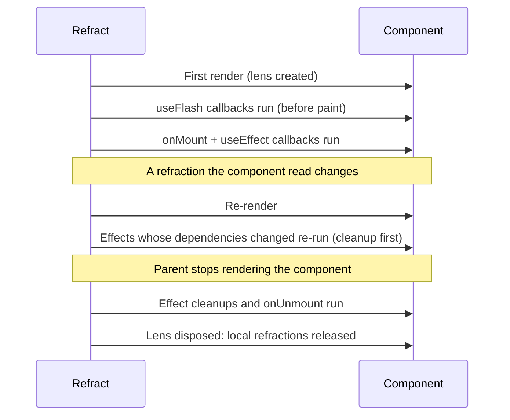

# Lenses

Every component receives a **lens**. A lens is the bridge between a component and Refract's reactive system: anything you create through it (refractions, derived values, effects) is owned by that component and disposed automatically when it unmounts.

```jsx
const TodoList = createComponent(({ lens }) => {
  const todos = lens.useRefraction([]);

  lens.useEffect(() => {
    fetchTodos().then(todos.set);
  }, []);

  return <ul>{todos.value.map((t) => <li key={t.id}>{t.title}</li>)}</ul>;
});
```

## Why lenses exist

In React, hooks rely on call order and a hidden "current component". Refract makes ownership explicit instead. The lens *is* the component's scope, so:

- you can see at a glance which state belongs to which component,
- you can pass the lens to a helper and the helper's state still belongs to the right component,
- there is no ambiguity about cleanup: when the component goes, everything on its lens goes too.

## What's on a lens

| Member | Purpose |
| --- | --- |
| `lens.props` | The component's props (also passed directly as `props`) |
| `lens.useRefraction(initial)` | Create local state |
| `lens.derive(fn)` | Create a local derived refraction |
| `lens.useEffect(fn, deps)` | Run a side effect after render |
| `lens.useOptic(fn, deps)` | Run a transition-aware side effect (shared when used inside an optic) |
| `lens.useFlash(fn)` | Run once after the first render, before paint |
| `lens.onMount(fn)` / `lens.onUnmount(fn)` | Lifecycle callbacks |
| `lens.context(key)` | Read a value provided by the app or an ancestor |
| `lens.provide(key, value)` | Make a value available to descendants |

The full signatures are in the [Lens API reference](../api/lens.md).

## Lifecycle



## Sharing values down the tree with context

To avoid passing a value through many layers of props, provide it from an ancestor and read it with `lens.context()`:

```jsx
const Layout = createComponent(({ lens, children }) => {
  lens.provide("locale", "en-GB");
  return <div class="layout">{children}</div>;
});

const Price = createComponent(({ props, lens }) => {
  const locale = lens.context("locale");
  return <span>{props.amount.toLocaleString(locale, { style: "currency", currency: "GBP" })}</span>;
});
```

If you provide a refraction, every consumer stays reactive to it.

## Lenses in optics

Optics (reusable logic) can call top-level functions such as `useRefraction()` and `useOptic()`. When an optic runs during a component's render, those calls are attached to that component's lens automatically. You can also accept the lens explicitly, which makes ownership obvious:

```js
export function useCounter(lens, start = 0) {
  const count = lens.useRefraction(start);
  return { count, increment: () => count.update((n) => n + 1) };
}
```

Both styles are supported. One difference matters for shared optics (optics that call `useOptic`): Refract shares them between components that pass the same arguments, and every component's lens is different. An optic that takes the lens as an argument is therefore never shared. Use that when each component needs its own instance. See [Optics](./optics.md#how-sharing-works).

## Related

- [Lens API reference](../api/lens.md)
- [Side effects](./side-effects.md)
