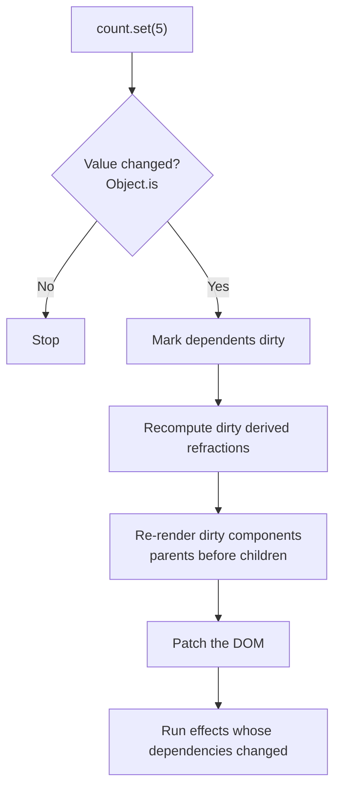

# The reactivity model

You can build Refract apps without reading this page. It explains what happens under the hood, which helps when you are debugging an update that did or didn't happen, or tuning performance.

## Automatic dependency tracking

Refract tracks dependencies by observing reads. While a component renders (or a derived refraction or effect runs), Refract records every refraction whose `.value` is read. Those refractions become that component's **dependencies**.

```jsx
const Summary = createComponent(({ lens }) => {
  // Dependencies after this render: user, cart
  return <p>{user.value.name} has {cart.value.length} items</p>;
});
```

Dependencies are recalculated on every run. If a branch stops reading a refraction, the component stops depending on it:

```jsx
// While showDetails is false, changes to details do not re-render this component
{showDetails.value ? <Details data={details.value} /> : null}
```

## The update cycle



Three properties fall out of this design:

- **Precision.** Only components that read the changed refraction re-render. Siblings and parents are untouched.
- **Glitch-free.** Derived refractions update before components render, so a component never sees a half-updated state.
- **Batched.** All `.set()` calls in the same event handler, or inside [`batch()`](../api/batch.md), produce one update cycle.

## Rendering and the DOM

Refract uses a lightweight virtual DOM at the component level: when a component re-renders, its new JSX is diffed against the previous output and only changed nodes are patched. Because few components re-render per update, diffs stay small.

With `compiler.optimize` enabled (the default), the [compiler](../api/config.md#compiler) goes further. It detects JSX expressions that read a single refraction, such as `{count.value}`, and binds them directly to a text node, skipping the diff entirely.

## Rendering on the server

Refract can render your app to HTML on the server, so visitors see content before any JavaScript loads. This speeds up the first page load and lets search engines read the page. Render with `renderToString()` from `"refract/server"`. In the browser, call `hydrate()` instead of `mount()`, so Refract takes over the existing HTML instead of rebuilding it.

```js title="server.js"
import { createApp } from "refract";
import { renderToString } from "refract/server";
import { App } from "./src/App";

export function renderPage() {
  const html = renderToString(createApp(App));
  return `<!doctype html>
<div id="root">${html}</div>
<script type="module" src="/src/main.js"></script>`;
}
```

```js title="src/main.js"
import { createApp } from "refract";
import { App } from "./App";

createApp(App).hydrate("#root");
```

On the server, a few things work differently:

- **Effects don't run.** `useEffect`, `useOptic` and `useFlash` run only in the browser, so data fetched in an effect isn't in the server HTML. To include it, load the data before rendering and pass it in with `props` or `app.provide()`.
- **Streams don't start**, and transitions render their target value without animating.
- **Create a new app for each request.** Global refractions live as long as the server process and are shared by every request, so never store one user's data in them. Use `app.provide()` for per-request values.
- **Guard browser-only code.** Reading `window`, `localStorage` or `navigator` during render or at the top of a module fails on the server. Move that code into an effect, or check `typeof window !== "undefined"` first.
- **The browser's first render must match the server's HTML.** If it doesn't, Refract warns about a hydration mismatch in development and re-renders the components that differ.

## Stream-based updates

Refractions can also be fed by asynchronous streams (WebSockets, server-sent events, async iterators). [`fromStream()`](../api/from-stream.md) turns a stream into a read-only refraction, so live data flows through the same update cycle as user input. See the [Streams guide](../guides/streams.md).

## Related

- [Refractions](./refractions.md)
- [`batch()`](../api/batch.md)
