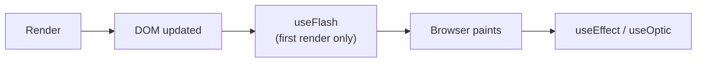

# Side effects

A side effect is anything a component does besides returning JSX: fetching data, setting a timer, subscribing to an event, measuring the DOM, starting an animation. Refract keeps components pure by moving that work into **effect hooks**. Effects are opt-in and always scoped to the component that created them, so there is no ambiguity about when they run or when they stop.

## Choose the right hook

| Hook | Runs | Use it for |
| --- | --- | --- |
| [`useEffect`](../api/use-effect.md) | After render and paint; again when dependencies change | Data fetching, logging, syncing with storage, most effects |
| [`useOptic`](../api/use-optic.md) | Like `useEffect`, but inside an optic it is shared, with the optic's state, by components that pass the same arguments. Paused during transitions | Subscriptions and data sources inside reusable optics |
| [`useFlash`](../api/use-flash.md) | Once, after the first render, **before** the browser paints | Measuring layout, setting focus, starting an entrance animation |



## Dependencies

`useEffect` and `useOptic` take a dependency array as the second argument:

| Dependency array | The effect runs |
| --- | --- |
| Omitted | After every render |
| `[]` | Once, after the first render |
| `[a, b]` | After the first render and whenever `a` or `b` changes |

You can list refractions directly. Refract compares their **values**, so you write `[query]`, not `[query.value]`:

```js
lens.useEffect(() => {
  search(query.value).then(results.set);
}, [query]);
```

## Cleanup

Return a function from the effect to undo it. Refract calls the cleanup before the effect re-runs and when the component unmounts:

```js
lens.useEffect(() => {
  const id = setInterval(() => now.set(new Date()), 1000);
  return () => clearInterval(id);
}, []);
```

Forgetting cleanup is the most common source of memory leaks. A good rule: if the effect *starts* something (a timer, a listener, a socket, a request), the cleanup should *stop* it.

## `useFlash` for work that must happen before paint

Effects that change what the user sees on the first frame should use `useFlash`, which runs once, synchronously, before the browser paints. That avoids a visible flicker:

```jsx
const Tooltip = createComponent(({ props, lens }) => {
  const el = lens.useRefraction(null);
  const placement = lens.useRefraction("top");

  lens.useFlash(() => {
    const rect = el.value.getBoundingClientRect();
    if (rect.top < 40) placement.set("bottom");
  });

  return <div ref={el.set} class={`tooltip tooltip--${placement.value}`}>{props.text}</div>;
});
```

:::caution
`useFlash` blocks painting. Keep it short. Anything that doesn't affect the first frame belongs in `useEffect`.
:::

## Related

- [Optics](./optics.md)
- [Animations guide](../guides/animations.md)
