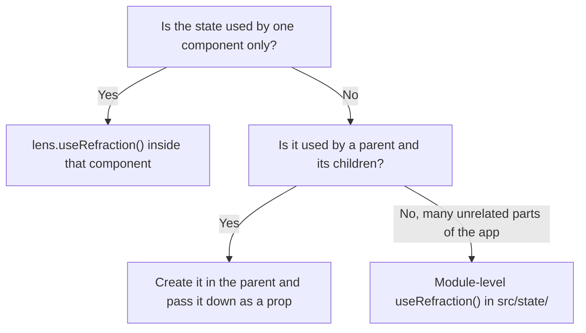

# Project structure

A new app created with the `starter` template looks like this:

```text
my-app/
├── public/                 # Static files copied to the build as-is
│   └── favicon.svg
├── src/
│   ├── components/         # Reusable UI components
│   │   └── Header.jsx
│   ├── optics/             # Reusable logic (custom optics)
│   │   └── useTheme.js
│   ├── state/              # Global refractions shared across the app
│   │   └── session.js
│   ├── pages/              # Route-level components (starter template only)
│   │   └── Home.jsx
│   ├── App.jsx             # Root component
│   └── main.js             # Entry point: creates and mounts the app
├── index.html              # HTML shell with the #root mount point
├── refract.config.js       # Compiler and dev-tool settings
├── vite.config.js          # Bundler config with the Refract plugin
└── package.json
```

The `minimal` template contains only `src/App.jsx`, `src/main.js`, `index.html` and the config files.

## Key files

### `src/main.js`

The entry point. It creates the application from the root component and mounts it into the page:

```js title="src/main.js"
import { createApp } from "refract";
import { App } from "./App";
import "./styles.css";

createApp(App).mount("#root");
```

This is also where you install plugins and provide app-wide values. See [`createApp()`](../api/create-app.md).

### `refract.config.js`

Configures the compiler and development tools. The defaults work for most apps:

```js title="refract.config.js"
import { defineConfig } from "refract/config";

export default defineConfig({
  compiler: { optimize: true },
  devtools: true,
});
```

Every option is listed in the [configuration reference](../api/config.md).

## Conventions

Refract does not enforce a folder layout, but these conventions keep larger apps easy to navigate.

| Convention | Why |
| --- | --- |
| One component per file, named in PascalCase (`UserCard.jsx`) | Matches the export name, so imports are predictable |
| Optics named `useSomething` and kept in `src/optics/` | The `use` prefix tells readers (and the compiler's lint rules) that the function must run during render |
| Global refractions in `src/state/`, one concern per file | Keeps shared state discoverable and avoids circular imports |
| Co-locate tests as `Component.test.jsx` | The Refract test runner picks them up automatically |

### Where should state live?



Read [Refractions](../concepts/refractions.md#local-and-global-refractions) for the trade-offs.

## Next steps

- Using TypeScript? See [TypeScript support](./typescript.md).
- Learn the model behind the files in [Components](../concepts/components.md).
